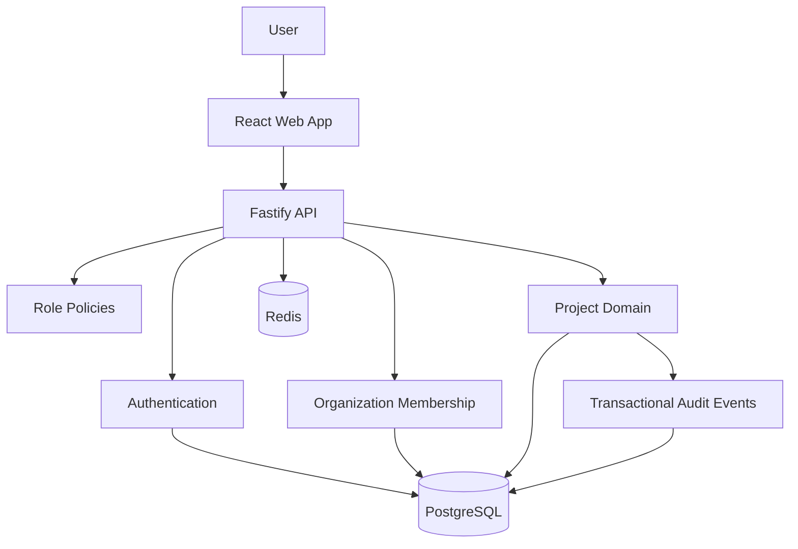

# ForgeOps
### Full-stack Operations Platform

**A multi-tenant SaaS foundation for managing teams, projects and operational activity — built with security, traceability and maintainability in mind.**

<p align="left">
  
  
  
  
  
  
  
</p>

ForgeOps is an actively developed portfolio project exploring the engineering foundations of a business operations product. The goal is not simply to demonstrate CRUD screens, but to show how identity, tenant boundaries, permissions, business rules and auditability fit together in a coherent application.

## Product overview

The platform currently brings together:

- **Identity and access:** JWT-based authentication, password hashing with Argon2id and organization membership.
- **Multi-tenancy:** organization context is resolved against persisted membership; a client-provided organization ID is never accepted as proof of access.
- **Role-based authorization:** OWNER, ADMIN, MANAGER, MEMBER and VIEWER roles.
- **Project operations:** create and list projects, with controlled status transitions.
- **Audit trail:** important mutations generate audit events inside the same database transaction.
- **Web application:** React dashboard with login, organization switching, project workflows and an audit timeline for authorized roles.
- **Operational foundation:** Docker Compose, PostgreSQL, Redis, health endpoints, structured logs, OpenAPI documentation and GitHub Actions.

## Architecture

The project follows a modular-monolith approach: clear domain boundaries without introducing distributed-system complexity before it is needed.



### Technology choices

| Layer | Technology | Responsibility |
|---|---|---|
| Web | React + Vite + TypeScript | Dashboard and user workflows |
| API | Node.js + Fastify + TypeScript | HTTP application and domain routes |
| Persistence | PostgreSQL + Prisma | Relational data and migrations |
| Cache / limits | Redis | Rate limiting and supporting infrastructure |
| Security | JWT + Argon2id | Authentication and password hashing |
| Operations | Docker Compose | Reproducible local environment |
| Quality | GitHub Actions + Vitest | Automated validation and tests |

## Engineering decisions

- **Authorization is server-side:** organization membership is checked for scoped operations.
- **Audit and business writes are atomic:** a failed audit write must not leave the business mutation committed without its trace.
- **Status changes are concurrency-aware:** conditional updates prevent stale state transitions from silently overwriting newer data.
- **Schemas define the API boundary:** request data is validated before reaching application logic.
- **Infrastructure has health checks:** liveness and readiness are separate concerns.
- **Secure defaults matter:** proxy trust is not enabled indiscriminately, secrets are configured through environment variables, and the API container runs as a non-root user.

More detail is available in the [platform documentation](platform/README.md) and the Architecture Decision Records.

## Run locally

Requirements: Docker and Node.js 22.

```bash
cd platform
cp .env.example .env
docker compose up -d
npm install
npm run prisma:generate
npm run db:migrate
npm run db:seed
npm run dev
```

Open the API documentation at [http://localhost:4000/docs](http://localhost:4000/docs). Start the web application using the scripts documented in [platform/README.md](platform/README.md).

> Configure the environment variables in `.env` before starting the services. Never commit real secrets.

## Quality gates

The backend CI pipeline currently passes the configured checks:

- dependency installation
- Prisma schema validation
- Prisma Client generation
- TypeScript type-checking
- automated test suite

The web build and repository-level checks have also passed in the current development workflow. These checks are useful signals, not a substitute for production deployment, security review, integration coverage or load testing.

## Roadmap

- [ ] Refresh-token rotation and session lifecycle
- [ ] Deeper API integration and authorization tests
- [ ] Background jobs and asynchronous workflows
- [ ] Expanded organization and user administration
- [ ] Observability, metrics and deployment pipeline
- [ ] Security review and performance/load testing

## Project status

**Active development — foundation implemented; not production-ready.**

ForgeOps is a work in progress. Features, architecture and documentation will evolve as the platform grows. Production readiness will only be claimed after the relevant security, operational and performance requirements have been implemented and verified.

## Author

**Samuel Aguiar** · [Portfolio](https://samuelaguiar.discloud.app) · [GitHub](https://github.com/0AKZ0)

[MIT License](LICENSE)
