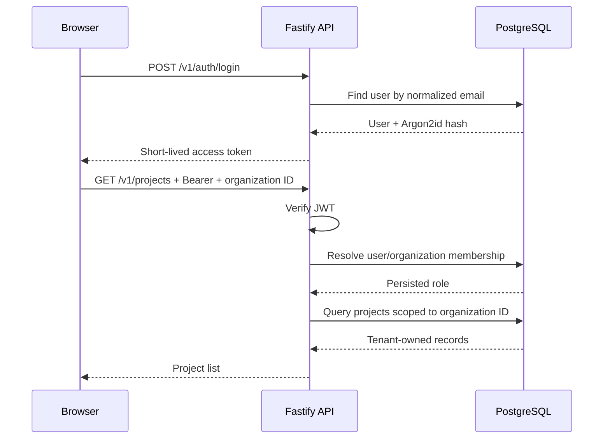

# System context

ForgeOps is a browser-based workspace for organizations managing operational projects.

## Actors

- **Workspace member:** signs in and works within organizations they belong to.
- **Workspace administrator:** manages access and reviews audit history.
- **Platform operator:** deploys and observes the service but should not gain implicit access to customer business data.

## Core request flow

## Mutation consistency

Project creation and its audit event are committed atomically. The API never accepts an actor ID or tenant role from the browser; both are derived from the authenticated identity and persisted membership.
